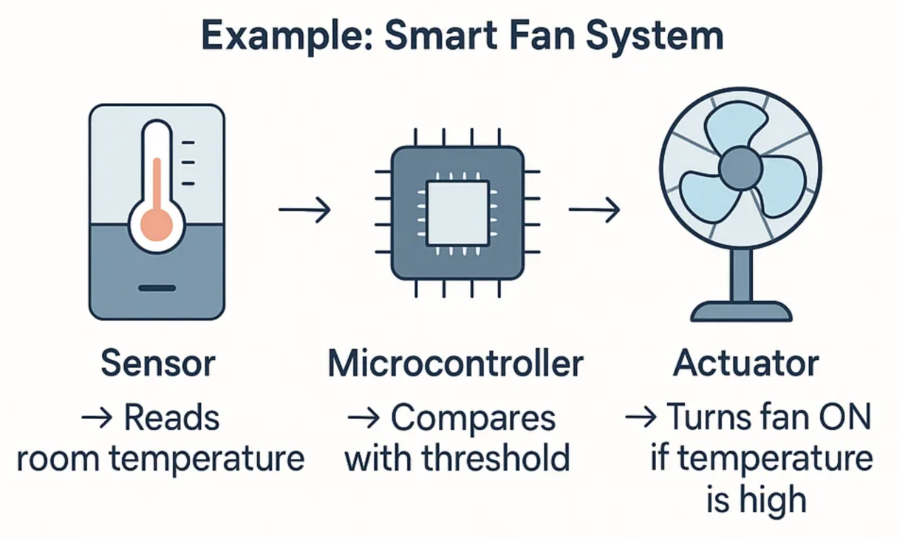
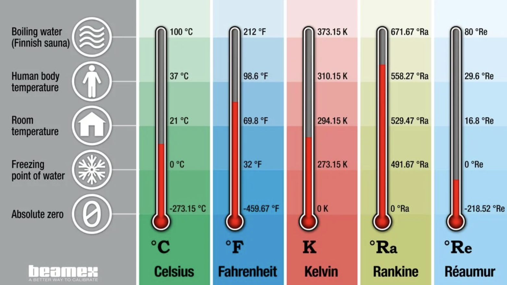

## Measurements and Fundamentals

<a href="../index.html?contents.md" target="_self">← All lectures</a>

  

 Terms and Definitions

<strong style="color: blue">Measurement
</strong>.

- Is the estimation of a magnitude of some attribute of an object relative to a unit of measurement

- Usually involves using a measuring instrument, which is calibrated to compare the object to some standard.

<strong style="color: blue">Sensor
</strong>.

- Converts physical or chemical/biological values, or their changes, into electrical values and their changes (over time).

- A device that provides information about the physical, chemical or biological state of a system.
  
---

## <strong style="color: blue">Transducer
</strong>

  

- An electronic device which converts energy from one form to another, such as a microphone, which changes sound waves into electrical signals.

Some Examples

| Device              | Type              | Why?                                                      |
|---------------------|-------------------|-----------------------------------------------------------|
| Thermistor          | Sensor            | Detects temperature change                                |
| Thermocouple        | Transducer        | Detects temperature **and** converts it into a voltage    |
| Photodiode          | Sensor/Transducer | Detects light and converts it into an electrical current  |
| Microphone          | Transducer        | Detects sound **and** converts it into an electrical signal |

**Quick check:**

**1. A device that only detects a temperature change is called a…**

- [[ ]] Transducer
- [[x]] Sensor

**2. A microphone is best classified as a…**

- [[ ]] Sensor
- [[x]] Transducer
  
---

## Actuator

  

- Part of a machine or system that moves something or makes something work.
  
 
---

## SI Basic Units

  

<strong>Length → meter (m)</strong>

The length of the path traveled by light in vacuum in 1/299,792,458 of a second. **(1983)**

<strong>Mass → kilogram (kg)</strong>

After a platinum-iridium prototype. **(1889)**

<strong>Time → second (s)</strong>

The duration of 9,192,631,770 periods of the radiation corresponding to the transition between the two hyperfine levels of the ground state of the cesium-133 atom. **(1967)**

<strong>Electric current → ampere (A)</strong>

Force equal to 2 × 10⁻⁷ N/m of length exerted on two parallel conductors in vacuum when they carry the current. **(1946)**

<strong>Thermodynamic temperature → kelvin (K)</strong>

The fraction 1/273.16 of the thermodynamic temperature of the triple point of water. **(1967)**

<strong>Amount of substance → mole (mol)</strong>

The amount of substance which contains as many elementary entities as there are atoms in 0.012 kg of carbon 12. **(1971)**

<strong>Luminous intensity → candela (cd)</strong>

Intensity in the perpendicular direction of a surface of 1/600,000 m² of a blackbody at temperature of freezing Pt under pressure of 101,325 N/m². **(1967)**

<strong>Plane angle → radian (rad)</strong>

Supplemental unit.

<strong>Solid angle → steradian (sr)</strong>

Supplemental unit.

 

---

## Example: Temperature as a Measurement

  

Temperature shows nicely how a **unit of measurement** works: the same physical temperature can be written in different scales, as long as everyone agrees on a reference point.

| Reference point | Celsius (°C) | Fahrenheit (°F) | Kelvin (K) |
|---|---|---|---|
| Boiling water | 100 °C | 212 °F | 373.15 K |
| Human body temperature | 37 °C | 98.6 °F | 310.15 K |
| Room temperature | 21 °C | 69.8 °F | 294.15 K |
| Freezing point of water | 0 °C | 32 °F | 273.15 K |
| Absolute zero | -273.15 °C | -459.67 °F | 0 K |

- **Celsius** is anchored to water: 0 °C = freezing, 100 °C = boiling
- **Fahrenheit** uses a different zero point, historically based on a salt-ice mixture
- **Kelvin** starts at *absolute zero* (the coldest possible temperature) so it has no negative values

  <small>Source: <a href="https://blog.beamex.com/temperature-units-and-temperature-unit-conversion">Beamex – Temperature units and conversion</a></small>

**Quick check:**

What is 0 °C in Kelvin?

- [( )] 0 K
- [( )] 100 K
- [(X)] 273.15 K
- [( )] -273.15 K      

---

---

## Sensor → Measuring Instrument

A **sensor** is a device that detects a physically measurable quantity and produces an equivalent **electrical signal**.

In simple words:

> **A sensor receives a stimulus and responds with an electrical signal.**

### 1. What enters the sensor?

The **input** is called a **stimulus**.

A stimulus can be a physical quantity, property, or condition that can be measured.

<strong>Examples of stimuli</strong>

- Light intensity
- Wavelength
- Sound
- Force
- Acceleration
- Temperature
- Pressure
- Rate of motion

---

### 2. What does the sensor do?

The sensor **detects the stimulus** and converts it into an electrical signal.

**Stimulus** → **Sensor** → **Electrical Signal**

For example:

**Temperature** → 🌡️ **Temperature Sensor** → **Voltage**

The electrical signal may be represented as a **voltage, current, charge, or impedance**.

---

### 3. The mathematical idea

The stimulus can be represented by **m**, while the sensor's output signal is represented by **s**.

Therefore:

**s = F(m)**

This means that the output signal **s** is a function of the measured quantity **m**.

> By measuring **s**, we can determine the value of **m**.

---

### Sensor sensitivity

For a **linear sensor**, a change in the measured quantity produces a proportional change in the output signal:

**Δs = S · Δm**

where **S** is the sensor's sensitivity.

For a nonlinear sensor:

**S = ds/dm**

<strong>💡 What does sensitivity mean?</strong>

Sensitivity describes how much the output signal changes when the measured quantity changes.

A highly sensitive sensor produces a relatively large change in its output for a small change in the input.

---

### Quick self-check

**Which sequence correctly describes the basic operation of a sensor?**

[( ) Electrical signal → Sensor → Stimulus]

[(X) Stimulus → Sensor → Electrical signal]

[( ) Sensor → Stimulus → Electrical signal]

[( ) Stimulus → Electrical signal → Sensor]

---

**Think about this example:**

A temperature sensor detects a change in temperature and produces a change in voltage.

- **What is the stimulus?** → Temperature
- **What is the sensor?** → Temperature sensor
- **What is the output?** → Electrical signal (e.g. voltage)

<strong>🔎 Key idea to remember</strong>

A sensor acts as a **translator**:

**non-electrical quantity → electrical signal**

This allows a physical quantity to be measured, processed, amplified, or displayed by an electronic system.

---
